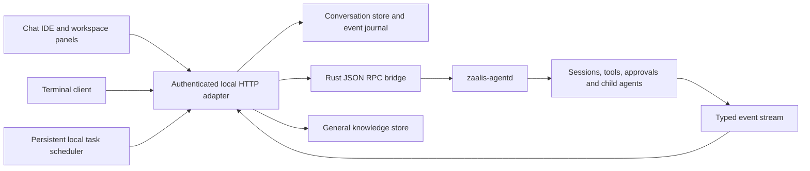

# Shared conversation runtime

The desktop and user-facing terminal call the same local HTTP adapter and Rust daemon. Changes extend the existing Chat IDE layout and typed event protocol. Plugins remain outside this implementation.

## Module ownership

| Module | Responsibility | Boundary |
| --- | --- | --- |
| `src/app/server.js` | Compose services, existing account guards, provider configuration and daemon adapter | No alternate authentication or provider implementation |
| `src/services/conversation-store.js` | Conversation CRUD, forks, legacy reconciliation and interrupted-turn recovery | Account id comes from the authenticated caller |
| `src/services/conversation-events.js` | Ordered JSONL event journal and cursor replay | A conversation must belong to the caller before HTTP replay |
| `src/services/json-store.js` | Same-volume atomic JSON replacement and storage keys | Never treats malformed existing JSON as an empty writable store |
| `src/services/task-service.js` | Persisted schedules, bounded concurrency, pending decisions, cancellation and run history | Jobs resolve the account and current provider configuration when run |
| `src/services/agent-request.js` | Internal task execution through the normal HTTP handler | Reuses normal permissions, cancellation and interactive decisions |
| `src/services/memory-store.js` | Explicit account/project/global knowledge and bounded retrieval | Separate from automatic correction memory |
| `src/services/workspace-services.js` | Agent access to tasks, knowledge and prior project conversations | Agent token fixes account and project; cross-project mutations are refused |
| `src/services/parity-routes.js` | Small authenticated route adapters | Mounted after account/mobile/tunnel policy |
| `src/cli/` | Streaming state, shared conversation client and terminal commands | The terminal stores shared conversation/runtime ids |
| `interface/script/conversation-actions.js` | Search, rename, archive, fork and open | Existing conversation renderer restores the transcript |
| `interface/script/task-center.js` | Task, knowledge and tool panels | Opening a panel never starts a model request |
| `interface/script/pending-queue.js` | Editable ordered drafts and attachment identity | Drafts remain in memory and cannot cross conversations |
| `interface/script/clarification.js` | Accessible queued structured questions | Answers return to the pending native tool call |
| `interface/script/agent-activity.js` | Child-agent lifecycle, counted groups, reports and timestamps | Native events determine status; conversation storage retains the history |
| Rust `progress.rs` | Stream a bounded provisional preview and release the complete final answer | Tool rounds show at most 280 Unicode characters; complete model history is retained |
| Rust `discovery.rs`, `clarify.rs`, `agent_control.rs` | Tool discovery, clarification and child-agent controls | Existing native guards, budgets and isolation remain authoritative |

## Identity and lifecycle

`conversation.id` identifies a visible history item. `sessionId` identifies its durable Rust runtime. A continuation restores that runtime when the workspace, model and permission configuration remain compatible. A fork copies the transcript into a new conversation and deliberately omits the parent's runtime id.

The canonical lifecycle API is `/api/conversations`: list/search/create, get, rename/archive, fork, delete and ordered event replay. The existing `/api/chats` array API remains an adapter for desktop/mobile/messaging clients. Reconciliation protects canonical metadata and runtime fields from stale bulk saves. Deletion records an account-scoped tombstone, so an older window cannot recreate the deleted item. Event journals are stored under application data, not source or `dist`.

The main terminal entrypoint is `src/app/cli.js`, built as `zaalis-terminal.exe` and installed as `bin/zaalis.exe`. The Rust `zaalis-cli.exe` is a direct daemon client for diagnostics; it is not a second shared conversation database.

## Tasks and knowledge

`/api/tasks` supports creation, editing, pause, manual run, cancellation and deletion. Optional `intervalMinutes` or `runAt` schedules executions while the application is open. Jobs never overlap themselves, and the service has a bounded concurrent-run limit. Interactive jobs remain waiting until the user answers the normal approval or clarification request. On restart, interrupted jobs are labelled and can resume using their saved conversation; missed recurrent executions do not create a catch-up storm.

`/api/knowledge` manages explicitly saved general knowledge. The older `/api/memory` endpoints continue serving correction memory. Retrieval adds only bounded relevant knowledge to the current turn. Workspace tools may read global knowledge, but may modify only records belonging to their current project. The desktop and CLI can manage their authenticated account's records directly.

## Native tool safety and background work

`tool_search` and `tool_describe` inspect the active registry. `tool_call` resolves the target before the existing permission guard, preserves target accounting and hooks, and rejects recursive aliases or tools excluded from the current catalogue.

`request_user_input` emits typed clarification events and waits cancellably for `clarification.decide`. Invalid answers do not consume the pending request. `spawn_agent` can return a background child's id immediately; `agent_status`, `agent_wait` and `agent_cancel` are scoped to its parent. The enclosing turn stays open until children settle. These child tasks do not survive as autonomous processes after the application exits.

## Verification entrypoints

- `npm test`: service isolation, stale-save reconciliation, task lifecycle, frontend interactions, real terminal subprocess and real HTTP/daemon continuation with a loopback provider fixture.
- `cargo test --manifest-path rust/Cargo.toml --workspace`: protocol bindings, guards, discovery, clarification, child-agent orchestration and existing runtime behavior.
- `scripts/qa/parity-fixture.js`: disposable local account/provider/project for visual chat, tool, diff, clarification, slow-stream and failure scenarios; see its adjacent README.
- `node test/package-smoke.js`: packaged-server checks after rebuilding `native/dist`.

When adding a capability, extend a dedicated service or presentation module and its boundary tests. Keep HTTP adapters, provider execution, persistent identity and view rendering separate.
