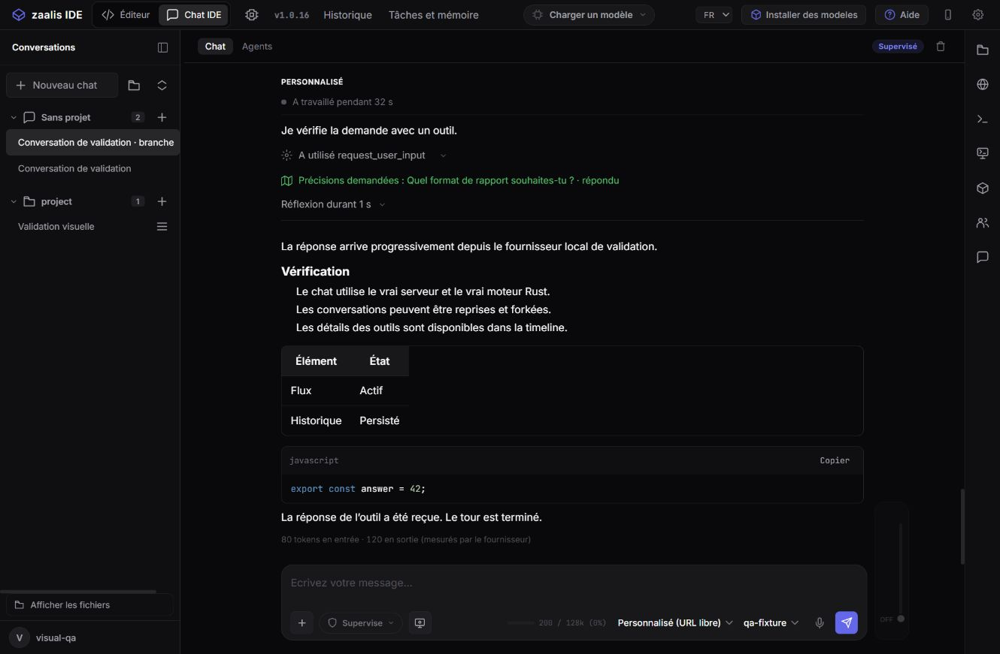
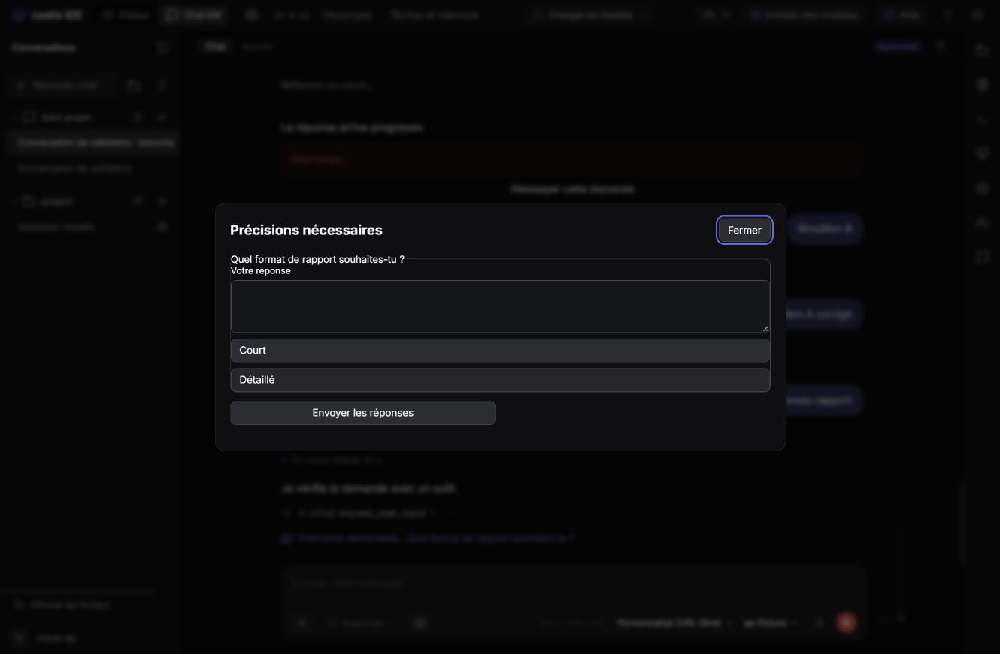
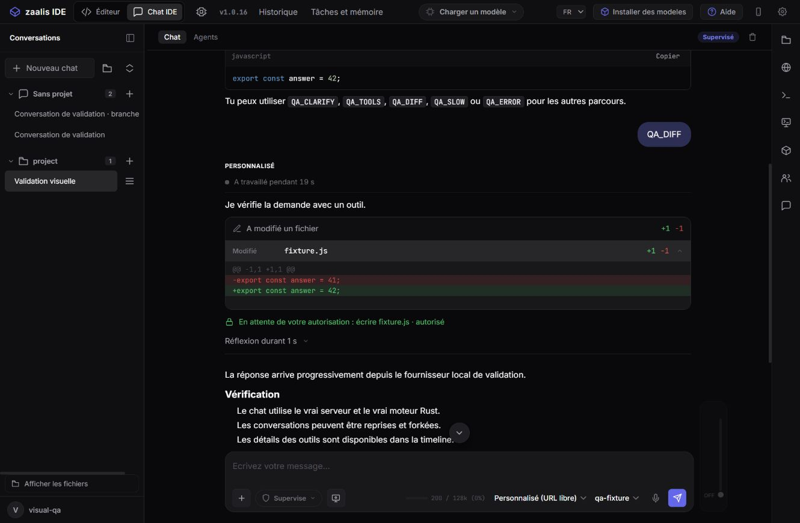
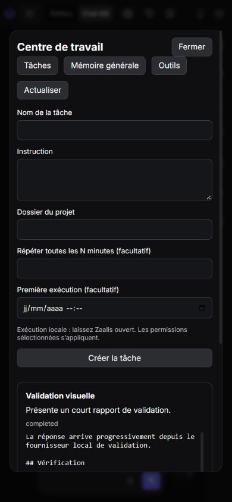

# Desktop and terminal conversation parity — 2026-10-15

Implemented on upstream `f7b3e92` (JavaScript source organization). The earlier
local changes, including the launch splash, were preserved through a named Git
stash while updating `main`, then restored and adapted to `src/`. Changes remain
local and uncommitted. No plugin marketplace was added.

## Capability and verification map

| Priority | Delivered behavior | Evidence |
| --- | --- | --- |
| P0 | Real terminal response streaming, lead/child isolation, no final duplicate | Real Node and packaged CLI subprocess tests observe output before `done` |
| P0 | Shared desktop/CLI conversations and durable native runtime continuation | Actual local HTTP server and Rust daemon: create, two turns with one session id, fork with new runtime and copied context |
| P1 | Search, rename, archive/restore, fork and canonical deletion | HTTP isolation/reconciliation tests; browser search/rename/fork/archive/restore checks |
| P1 | Editable ordered drafts with attachment identity, stop, retry and manual queue continuation | Frontend interactions plus visual two-message queue, reordering and cancellation |
| P1 | Structured clarification returning to the same tool call | Native validation tests, actual HTTP/daemon round trip and visible question/answer workflow |
| P1 | Real active tool search, description and guarded invocation | Registry/permission tests, live catalogue in the UI and packaged-server integration |
| P1 | Chat/Editor layout, tool timeline, diffs, reasoning, tables and copied code | Browser rendering of real native events; explicit write approval and file diff; Markdown safety tests |
| P2 | Explicit general knowledge with account/project/global scope and relevant recall | CRUD/retrieval/scope tests and visible save/persistence workflow; `/api/knowledge` preserves old correction-memory API |
| P2 | Local manual/one-shot/recurring tasks, pause, cancel and pending decisions | Deterministic scheduler tests and actual manual/scheduled daemon runs; task creation/execution/result verified visually |
| P2 | Concurrent child agents with status, bounded wait and cancellation | Native orchestration tests, isolation and direct-parent controls |
| Cross-cutting | Modular architecture and reproducible QA | [Runtime map](../architecture/conversation-runtime.md), small service/CLI modules, disposable provider/account/project fixture |

## Corrections found during integration

- Adapted restored imports and test entrypoints after the upstream `src/` move.
- Separated general knowledge routes from existing correction-memory routes.
- Protected canonical metadata and runtime identity from stale desktop bulk saves;
  retained tombstones and other-window conversations.
- Refused cross-project knowledge/task mutations through the agent workspace token.
- Fixed provider initialization after first login and tested its ordering.
- Added safe Markdown tables without interpreting fenced code as tables or HTML.
- Centered dialogs and kept the new toolbar controls reachable at 390 px.
- Fixed the terminal completion-marker echo race and ConPTY teardown errors;
  real attached-child cleanup and packaged PTY execution are covered.
- Finalized reasoning segments when a user stops a streaming response.

## Results

- `npm test`: **191 passed**, zero failures or skips.
- `cargo test --manifest-path rust/Cargo.toml --workspace`: **492 passed**,
  including the documentation test; zero failures.
- Packaged CLI tests: **6 passed**, including early streamed output and shared
  runtime continuation in a real executable subprocess.
- Packaged server/runtime integration: actual `zaalis-server.exe` and
  `zaalis-agentd.exe` passed continuation, fork, event replay, tool discovery,
  clarification, knowledge recall, manual and scheduled execution.
- Packaged smoke: canonical conversations, knowledge, tasks, actual PTY,
  interface assets and previous integration routes passed.
- Visual checks used the real application code, an actual daemon and a
  deterministic **loopback provider fixture**. No private provider key or user
  account was used, and no external model quality claim is implied.
- `git diff --check` and the source encoding check passed. The packager retains
  known warnings for optional Electron/browser dependency files; the native
  Windows server and actual runtime smoke checks succeeded.

## Distribution and operational limits

The ready-to-run build is in `native/dist`: `zaalis.exe`, `zaalis-server.exe`,
`zaalis-agentd.exe`, `zaalis-cli.exe`, `zaalis-terminal.exe` and staged assets.
`validation-manifest.json` records hashes, base revision, test totals and source
asset parity. The user-facing terminal is `zaalis-terminal.exe`; the Rust CLI
remains a direct diagnostic client. No installer was installed or published.

Scheduled jobs require the local application/server to remain open. Child
agents execute concurrently within the enclosing turn and are not independent
processes that survive application shutdown. Interrupted work is labelled for
recovery. Actual provider availability and response quality depend on the
configured account and model. The implementation reproduces the examined
conversation workflows using Zaalis code; it is not a claim of complete Codex
product or private-backend parity.

## Visual evidence

