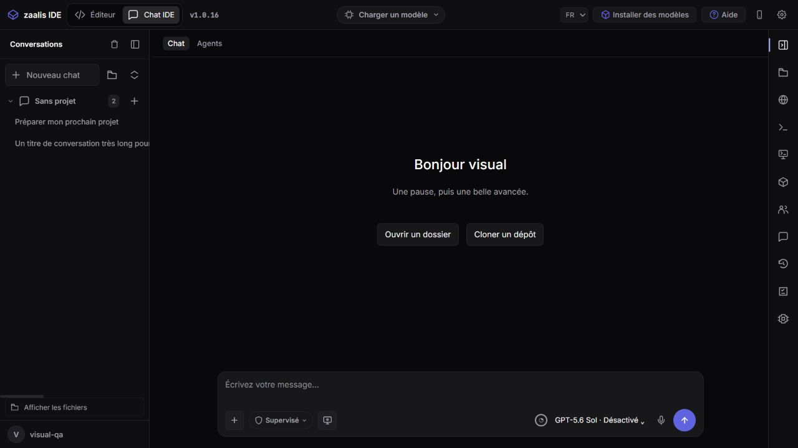
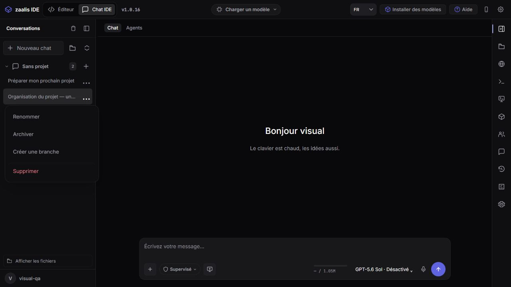
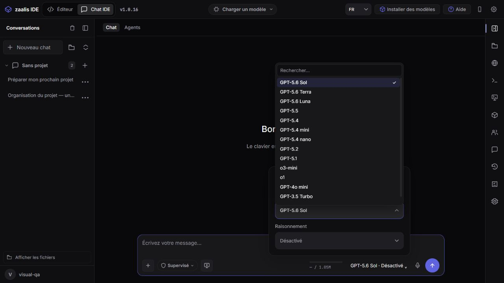
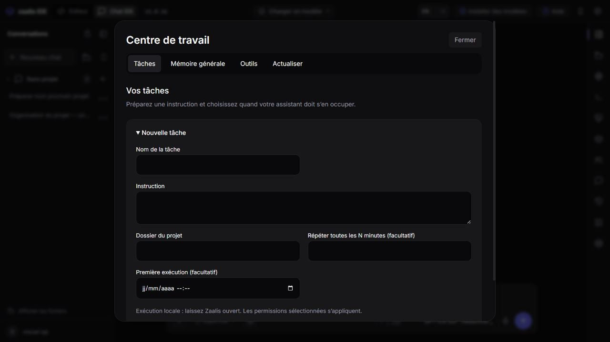
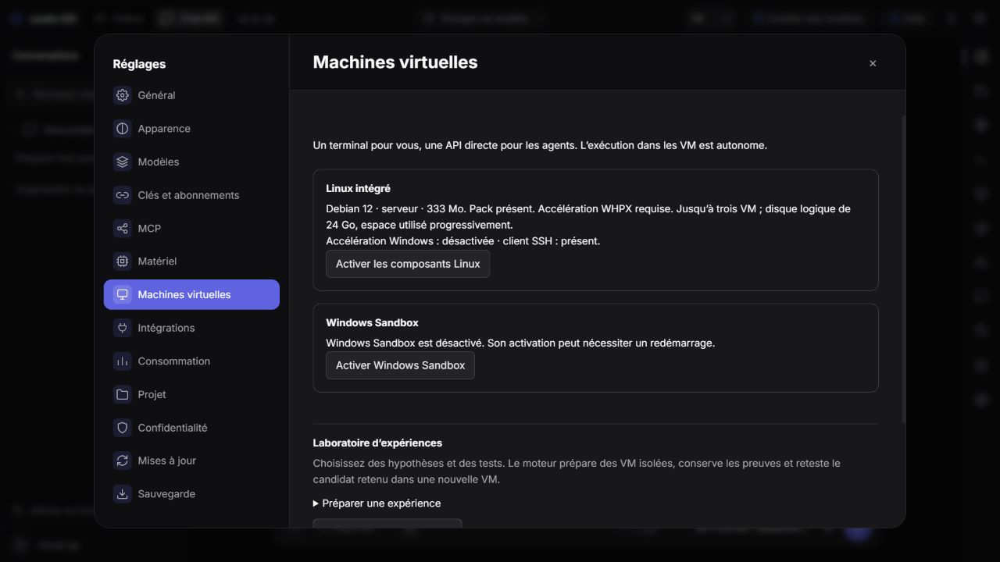
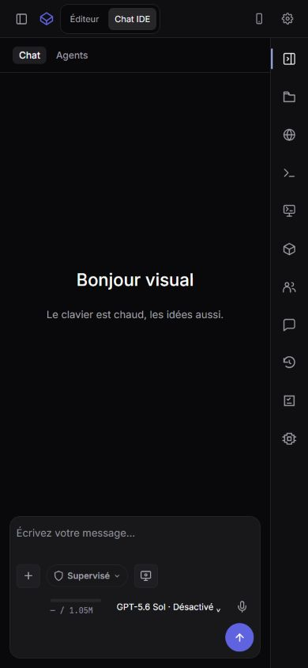

# Conversations et finition de l’interface — 15 octobre 2026

## Changements

| Zone | Correction intégrée |
| --- | --- |
| Conversations à gauche | Titres contenus dans leur colonne, points de suspension pour les noms longs, espace réservé aux actions. |
| Menu « … » | Renommer, archiver/restaurer, créer une branche et supprimer la conversation concernée ; navigation au clavier et fermeture avec Échap. |
| Historique | Cartes aérées, métadonnées plus lisibles, un seul menu d’actions par conversation. |
| Accueil | Seulement Bonjour/Bonsoir, prénom et phrase ; suppression des boutons ouvrir/cloner et des projets récents de cet écran. Les projets restent accessibles dans la navigation. |
| Réglages | Retour aux 13 sections : Général, Apparence, Modèles, Clés et abonnements, MCP, Matériel, Machines virtuelles, Intégrations, Consommation, Projet, Confidentialité, Mises à jour, Sauvegarde. |
| Centre de travail | Textes explicatifs, cartes et onglets plus espacés, création de tâche repliable, statuts en français. |
| Contexte | Petite barre horizontale avec compteur, cercle retiré. |
| Modèles | Listes affichées dans la couche supérieure pour éviter leur découpe ; noms pouvant revenir à la ligne. |
| Animations | Ouverture douce du chargeur, langue, modèles, menus « … », mode et pièces jointes. Respect du réglage système de réduction des mouvements. |

Les comportements communs sont regroupés dans `interface/script/action-menu.js` ; la finition visuelle dans `interface/interaction-polish.css`. Les fonctions existantes de VM et d’intégrations sont réutilisées.

## Vérifications exécutées

- `npm test` : **200 tests réussis**, aucun échec ; ajout d’un scénario de renommage d’une conversation agents depuis son menu.
- Serveur Windows recompilé ; test du serveur empaqueté réussi (`node test/package-smoke.js`), dont conversations, tâches, PTY et ressources statiques.
- Manifeste : **126 fichiers d’interface identiques aux sources**, composants Rust distribués conformes aux binaires release.
- Prévisualisation Chromium locale avec compte et conversations jetables : renommage effectif, titre long tronqué, accès aux actions, 13 sections visibles et contenu VM chargé.
- Contrôle du menu des modèles au-dessus de son cadre ; barre de contexte mesurée à 4 px ; animations assignées aux quatre menus demandés.
- Largeurs 390, 1 024 et 1 280 px : largeur du document égale à celle de la fenêtre. Aucun message d’erreur JavaScript dans la console de la page lors du contrôle final.

Limite : contrôle visuel effectué sur la prévisualisation locale, sans réinstallation ni contrôle interactif de cette version dans la fenêtre native Windows. Aucun modèle réel n’a été sollicité pour ces changements d’interface. Les composants C++ et Rust n’ont pas été modifiés pour cette passe.

## Captures

## Livraison

Distribution actualisée dans `native/dist`. Installateur : `native/installer/zaalis-setup.exe`.
Compilation réussie le 15 octobre 2026 à 17:14:32 ; taille : 498 102 203 octets.
SHA-256 : `d1ab9461f4da384ee25d95946928be5df523ab6ab88f687d3b2c3b568966e963`.
Les modifications restent locales dans le dépôt ; aucun push effectué pour cette passe.
