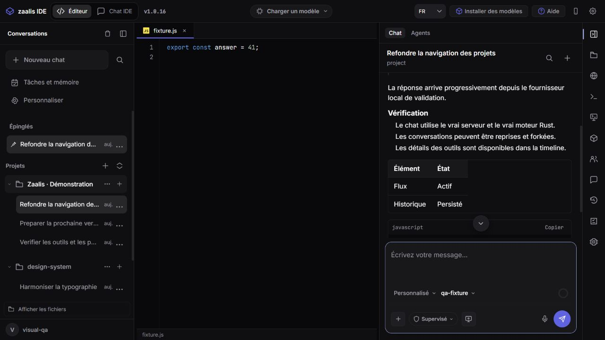

# Interface et outils IA — 13 novembre 2026

## Livraison

Navigation inspirée des captures fournies : action Nouveau chat, recherche, accès aux tâches et à la personnalisation, épingles, projets dépliables, conversations imbriquées et menus contextuels. Les projets peuvent être épinglés et recevoir un nom d’affichage sans renommer le dossier. Leur menu permet aussi d’ouvrir les fichiers, copier le chemin et retrouver les archives. Les conversations épinglées sont enregistrées par le serveur, par compte et par type ; une sauvegarde ancienne ne peut pas annuler leur état.

Dans l’éditeur, le chat affiche le titre de la conversation et le projet, avec recherche et nouveau chat. Le modèle et le contexte ont leur propre ligne ; saisie, pièces jointes, permissions, dictée et envoi restent accessibles. Les mêmes éléments sont déplacés entre les dispositions, ce qui conserve le brouillon et les flux.

Apparence propose désormais Système / Segoe UI, Inter, Humaniste / Candara et JetBrains Mono. Le choix est mémorisé ; le code conserve sa police indépendante. Les polices web existantes ont un repli système.

## Corrections issues de l’audit

- **Budget Rust** : un lot renvoyé par le modèle pouvait dépasser la limite d’outils avant le contrôle du tour suivant. Vérification entre chaque appel, prolongation explicite, résultats de refus pour les appels non exécutés et historique complet pour la reprise. Accorder des outils, tours ou du temps supplémentaires conserve désormais le plafond de tokens si aucune extension de tokens n’est demandée.
- **Installations pentest concurrentes** : les appels au même outil rejoignent une seule installation ; création du venv et installations pip sont sérialisées entre outils Python.
- **Faux succès d’installation** : après la fin de l’installateur, l’exécutable ou les fichiers attendus doivent être détectés. Sinon, le travail est marqué en échec avec une explication.
- **Constats pentest** : une erreur de lecture ou un JSON corrompu ne produit plus silencieusement une liste vide ; le fichier existant est conservé et le rapport est bloqué avec une erreur explicite.
- **Dépendances** : correctifs compatibles appliqués dans les deux fichiers de verrouillage. `body-parser` 2.4.0 et `qs` 6.17.1 corrigent les alertes de production. Les dépendances de compilation, dont Electron et undici, ont également été actualisées dans leurs plages compatibles. Audit npm final : **0 vulnérabilité connue**, au niveau du dépôt comme du connecteur WhatsApp.
- **Compilation** : le manifeste compte les tests réussis séparément des tests ignorés et accepte les chemins des journaux de cette validation.

Les alertes de production sont documentées dans les avis [body-parser](https://github.com/advisories/GHSA-27r3-jxmh-p828) et [qs](https://github.com/advisories/GHSA-6pq8-jhm2-2vcw).

## Comparaison des moteurs

Sources consultées sur les dépôts publics le 13 novembre 2026 :

| Référence | Observation et conséquence pour Zaalis |
|---|---|
| [Codex — exécution des outils](https://github.com/openai/codex/blob/main/codex-rs/core/src/tools/parallel.rs), [routage](https://github.com/openai/codex/blob/main/codex-rs/core/src/tools/router.rs) | Codex distingue les outils parallélisables et les opérations exclusives, avec gestion de l’annulation. Zaalis exécute les appels d’un tour en séquence et dispose de `spawn_agents` pour les tâches déléguées. Les écritures ne sont pas rendues concurrentes arbitrairement. Cette livraison corrige le dépassement de budget, sans prétendre reproduire toute l’orchestration de Codex. |
| [Google Antigravity SDK — tool_runner.py](https://github.com/google-antigravity/antigravity-sdk-python/blob/main/google/antigravity/tools/tool_runner.py) | Le SDK valide/coerce les arguments et rassemble les résultats des outils concurrents en conservant leurs erreurs. Dans Zaalis, les schémas et la garde centrale, les résultats typés, les questions structurées et la continuité des appels/résultats sont couverts par les tests Rust et HTTP. Le SDK public ne représente pas toute l’application Antigravity. |
| [Claude Code — dépôt public](https://github.com/anthropics/claude-code) | Le dépôt consulté expose notamment documentation, exemples, plugins et historique des versions. Il n’a pas fourni un cœur d’exécution complet à comparer ligne par ligne. Aucune équivalence interne n’est affirmée. |

## Vérification

- **Node : 233 réussis, 0 échec, 2 ignorés** ; **Rust : 500 réussis, 0 échec**.
- Test supplémentaire sur le **serveur EXE recompilé**, avec le vrai daemon Rust : création, continuation, branche, archivage, recherche, rejeu des événements, découverte d’outils, clarification, mémoire et tâches manuelles/planifiées : réussi. Fournisseur simulé sur la boucle locale.
- Test dans l’interface : lecture réelle de `fixture.js` par le moteur Rust ; résultat affiché dans la timeline. Épinglage, renommage affiché, filtrage et persistance après rechargement vérifiés. Brouillon conservé entre Chat IDE et Éditeur. Aucun message d’erreur de console observé lors de cette vérification.
- Thèmes clair et sombre inspectés ; police Inter chargée et police de code indépendante vérifiées. Fenêtres de 375, 768 et 1024 pixels, plus paysage 900 × 480 : aucun débordement horizontal de page ou de saisie constaté. Le bouton d’envoi reste visible.
- **Installation réelle de WAFW00F 2.4.2** dans un dossier temporaire, puis exécution de `--version` : réussie. Dossier supprimé ensuite ; aucun scan lancé. Reproduction : `node scripts/qa/pentest-install-smoke.js`.
- Manifeste de distribution : **132 fichiers d’interface identiques aux sources**, binaires Rust identiques à la release, empreintes SHA-256 enregistrées dans `native/dist/validation-manifest.json`.
- Recompilés : serveur Node, cœur et CLI Rust, terminal, coque Windows C++ et installeur `native/installer/zaalis-setup.exe`. Aucune installation sur le poste, aucun commit ni push.

Installeur final : version **1.0.16**, **498 211 441 octets**. SHA-256 : `eb2c112cb977de4eb5fbd08df509239d26dee2b77c0f0939c864cfee80dd2adf` ; copie dans `native/installer/zaalis-setup.exe.sha256`.

## Contre-vérification (seconde passe, même jour)

Relecture complète du diff, tests relancés et interface exercée sur une instance isolée (compte et données temporaires).

- **Défaut corrigé — compaction du contexte en cours de tour** (`rust/crates/zaalis-agent/src/context.rs`). La compaction ne savait résumer que ce qui précédait la dernière demande. Un tour agentique normal (une demande, puis beaucoup d’appels d’outils) n’était donc jamais réduit et finissait en erreur « Contexte trop volumineux » : reproduit avec 40 lectures, 136 000 tokens estimés pour un budget de 12 000. Les anciens tours d’outils du tour courant sont maintenant résumés ; la première demande, la dernière demande et le dernier groupe appel/résultats restent intacts, sans jamais séparer un appel de son résultat. Deux tests ajoutés.
- **Menu « Historique et archives » d’un projet** : il ouvrait l’historique sans inclure les archives. La case est maintenant cochée.
- **Bouton d’options des conversations** : le caractère « … » était décalé vers le bas ; remplacé par la même icône que celle des projets.
- Corrections de la première passe relues et jugées correctes : budget d’outils par appel, plafond de tokens conservé, installations pentest regroupées et vérifiées, constats illisibles signalés, épingles persistées.

- **Barre d'envoi du chat (demande de l'utilisateur)** : le choix du modèle avait été mis sur une ligne séparée, au-dessus de la barre d'envoi. Il est revenu sur la même ligne que le micro, dans cet ordre : marque (Codex, Claude…), nom du modèle, fenêtre de contexte, micro, envoi. La disposition est la même dans Chat IDE et dans l'Éditeur. Dans le panneau étroit de l'Éditeur, le mode de permission n'affiche que son icône, sans la flèche ni le niveau de raisonnement, pour que les noms restent lisibles. Sur téléphone, ce groupe passe sous les boutons de gauche. Les menus s'ouvrent vers le bas s'il manque de place au-dessus et ne passent plus sous la barre « Chat / Agents ».
- **Éditeur sur téléphone** : la barre d'icônes de droite recouvrait le bouton d'envoi ; le panneau lui laisse maintenant la place.

Après ces corrections : **Node 233 réussis, 0 échec, 2 ignorés** ; **Rust 502 réussis, 0 échec**.

## Limites de cette validation

Cette livraison ne certifie pas « 100 % de toutes les fonctions » dans tous les environnements. Les deux tests ignorés concernent Blender réel. QEMU, Docker, SSH, les comptes cloud, les abonnements, les canaux de messagerie et les accès Daybreak n’ont pas tous été exercés avec des services réels pendant cette session. Le pentest possède des tests de bout en bout avec fournisseur local simulé ; seule l’installation WAFW00F a été exercée avec un téléchargement réel, sans test d’intrusion sur une cible.

Le packager conserve des avertissements concernant des dépendances optionnelles ; le serveur empaqueté a passé le test fonctionnel ci-dessus. Un audit npm sans alerte connue ne constitue pas une certification de sécurité. Les captures représentent exclusivement le projet et le fournisseur de validation, isolés des données utilisateur.

Les serveurs de validation ont été arrêtés. La suppression des deux dossiers temporaires `zaalis-parity-qa-*` de cette session a été refusée par le contrôle automatique (« blocked by policy ») ; ils sont conservés.
