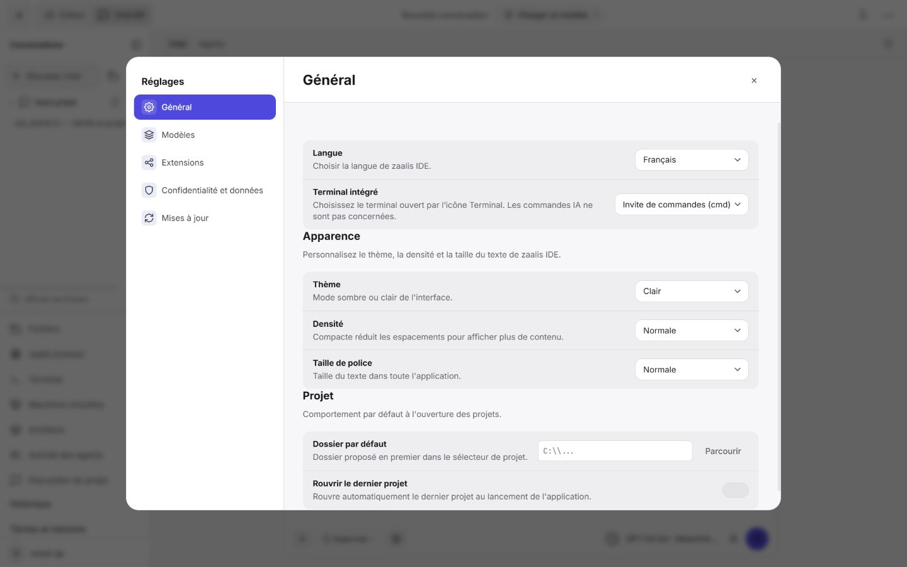
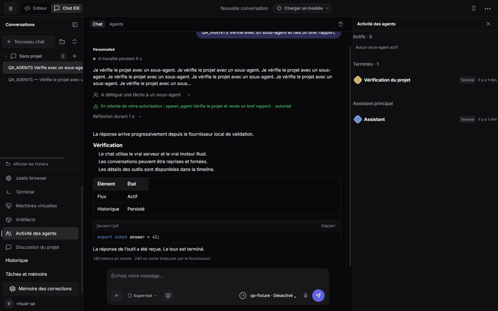

# Refonte de l’interface — 15 octobre 2026

> Rapport de la première refonte. La disposition a ensuite été ajustée à votre demande : voir [la correction de disposition](layout-restore-2026-10-15.md). Les captures et l’empreinte de l’installateur ci-dessous correspondent à la première livraison.

## Livraison

La copie de sauvegarde précédant cette refonte est le commit `79d8ef2`, déjà présent sur `origin/main`. La refonte ci-dessous est conservée dans le dossier de travail ; elle n’est pas encore poussée.

Application Windows : `native/dist/zaalis.exe`. Installateur : `native/installer/zaalis-setup.exe`. Version conservée : **1.0.16**. Les réglages et comptes de l’installation personnelle ne sont pas utilisés par les tests.

Compilation finale de l’installateur réussie le **15 octobre à 16:01**, taille **498 106 793 octets**. SHA-256 : `c18555180819c350f444c52e01f3ac24f30f4e592fc32c87a674f3b28f59d11d`.

## Cartographie du plan intégré

| Demande issue de l’audit | Mise en œuvre | Emplacement principal |
|---|---|---|
| Barre supérieure en trois groupes | Navigation et Éditeur/Chat ; contexte projet/fichier et chargeur ; mobile et menu de commandes | `script/shell-layout.js` |
| Version, langue, mémoire et réglages moins envahissants | Version dans le menu ; langue dans Général ; mémoire, historique et tâches dans la navigation ; réglages accessibles par menu et raccourci | `script/shell-layout.js` |
| Téléchargement sans doublon permanent | Commande conservée dans le chargeur et le menu, bouton indépendant masqué | `design-system.css` |
| Fournisseur, modèle, raisonnement réunis | Un menu dans le compositeur, réutilisant les catalogues existants et les capacités du modèle | `script/model-picker.js` |
| Réglette flottante et badge de permission répété | Masqués ; choix de mode conservé dans le compositeur | `design-system.css` |
| Contexte plus discret | Petit indicateur avec détails au clic, au survol et au focus | `script/model-picker.js` |
| Accent unique et identité des fournisseurs | Accent indigo, noms neutres et monogrammes ; couleurs sémantiques pour les états | `design-system.css` |
| Contraste et focus | Couleurs secondaires relevées dans les deux thèmes ; contour de focus visible | `design-system.css` |
| Apparence automatique | Mode système par défaut si aucune préférence antérieure ; suivi de `prefers-color-scheme` ; choix existants conservés | `script/ui-foundation.js` |
| Couleurs, typographie, rayons, espacements | Variables communes ; échelle de texte 26/22/17/15/13/12/11/10 ; rayons 6/10/14/20/pilule ; normalisation des feuilles de style de l’IDE | `design-system.css` et CSS existants |
| Titres et textes plus sobres | Suppression des capitales espacées et italiques décoratifs ; corrections d’accents et de libellés ; nom zaalis IDE harmonisé | HTML, `script/state.js`, `script/locale.js` |
| Cinq rubriques de réglages | Général, Modèles, Extensions, Confidentialité et données, Mises à jour ; anciens panneaux et fonctions regroupés | `script/settings-layout.js` |
| Réglages enregistrés immédiatement | Sauvegarde des préférences ordinaires ; retour à la valeur précédente et erreur visible si échec ; boutons locaux pour clés, MCP et connexion matérielle | `script/settings-persistence.js`, `script/main.js` |
| Outils du rail dans la navigation | Libellés et icônes dans la barre latérale ; inspecteurs existants conservés | `script/shell-layout.js` |
| Fenêtre étroite | Navigation repliée sous 1100 px ; panneaux en superposition sous 760 px ; réglages et compositeur adaptés | `design-system.css` |
| Agents moins chargés | Liste compacte, interrupteurs, détails rôle/modèle au clic ; suppression des badges Inactif répétés | `script/shell-layout.js` |
| Activité réelle des sous-agents | Panneau existant préservé : actifs, terminés et assistant principal ; testé avec un vrai moteur Rust et un fournisseur local de validation | `script/workspace.js` |
| Accueil avec actions utiles | Ouvrir un dossier, cloner, projets récents et rappel des raccourcis | `script/project-actions.js` |
| Clonage de dépôt | Dialogue HTTPS/SSH ; route authentifiée ; Git sans shell ; destination neuve et dossier temporaire propre au clonage ; annulation et délai maximal | `src/services/project-clone.js` |
| Envoyer et arrêter ronds | Même forme circulaire dans les deux états | `design-system.css` |
| Animations fonctionnelles | Transitions courtes et ciblées ; suppression des effets décoratifs ; prise en compte de la réduction des animations | CSS et `script/splash.js` |
| Raccourcis et palette | Ctrl/Cmd + virgule, N, O, B, W, Maj+P ; bascule Maj+E conservée ; routage natif Windows et Electron | `script/command-palette.js`, `native/AppShortcuts.h` |
| Accessibilité des contrôles | Libellés des boutons, focus, navigation des menus ; focus contenu dans les dialogues ; dialogues fermés inertes | `script/ui-accessibility.js`, `script/ui.js` |
| Autorisations intégrées au chat | Carte directement dans le fil ou la tâche ; mêmes décisions du moteur ; utilisable au clavier | `script/inline-approval.js`, `script/ai.js`, `script/task-center.js` |
| Sélecteurs cohérents | Composant personnalisé commun pour les listes de l’interface, avec libellé, état désactivé et événements de changement propagés | `script/ui.js`, `script/ui-accessibility.js` |

Les nouveaux modules restent séparés par responsabilité : fondations, réglages, persistance, commandes, modèles, projets, disposition, autorisations et accessibilité. Le mécanisme des agents et les intégrations existantes sont réutilisés.

## Vérification effectuée

- **199 tests Node réussis**, zéro échec : `.tmp/parity-final-node-tests.log`. Dont validation du clonage, protection contre une destination créée entre-temps, absence de shell et retour arrière des préférences en cas d’erreur.
- Compilation C++ Windows réussie : `.tmp/redesign-shell-build.log`.
- Serveur Windows empaqueté : test de démarrage, ressources, conversations, tâches, mémoire, terminal PTY réel, GGUF, préférences et intégrations réussi : `.tmp/redesign-package-smoke.log`.
- Test supplémentaire avec le **serveur empaqueté et le vrai daemon Rust** réussi : création/reprise/fork/recherche/archivage de conversations, découverte d’outils, clarification, mémoire et tâches : `.tmp/redesign-packaged-runtime.log`.
- Le manifeste compare **124 fichiers d’interface** entre les sources et `native/dist` et les exécutables Rust avec leurs binaires de compilation. Les **493 tests Rust** inscrits dans le manifeste proviennent de la validation précédente ; le code Rust n’a pas été modifié par cette refonte.
- Contrôle visuel dans le navigateur intégré : thèmes clair/sombre, accueil, réglages, menus, palette, liste des agents, carte d’autorisation et activité d’un sous-agent terminé.
- Largeurs vérifiées : **390, 768, 1024 et 1440 px**, sans débordement horizontal de la page ; navigation masquée à 768/1024 et visible à 1440.
- Autorisation réelle de `spawn_agent` cliquée dans le fil ; sous-agent observé dans « Terminés · 1 ». Le fournisseur local de validation émet volontairement un texte de progression trop long ; son affichage reste limité, la réponse finale garde son contenu.
- Aucune erreur JavaScript capturée pendant la dernière vérification.

## Limites des vérifications

Le fournisseur utilisé est un serveur local de validation, **pas Mistral 3 3B**. La nouvelle route de clonage est couverte par des tests de validation et de processus simulé ; aucun clonage distant authentifié n’a été réalisé. Les raccourcis ont été exercés dans le navigateur et le routage Windows a été compilé ; aucun test natif macOS/Linux ou installation de l’installateur sur le compte personnel n’a été effectué. Les contrôles visuels ne constituent pas une certification complète WCAG ni un test de chaque intégration tierce. L’affichage de sites tiers et leurs styles propres ne sont pas réécrits.

## Captures

Les captures se trouvent dans `assets/interface-redesign-2026-10-15/` : accueil clair aux trois largeurs bureau/tablette, accueil mobile, réglages mobiles et bureau, liste des agents, palette, autorisation dans le fil et activité d’un sous-agent terminé.

