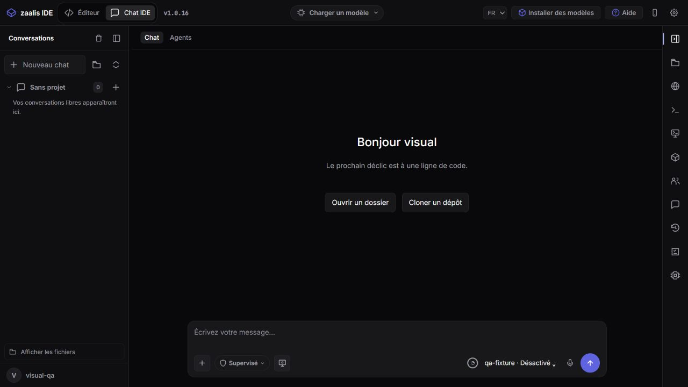

# Retour à la disposition précédente — 15 octobre 2026

## Modifications

- Outils Fichiers, navigateur, Terminal, VM, Artefacts, Activité des agents et Discussion replacés dans le rail de droite.
- Historique, Tâches et mémoire et Mémoire des corrections ajoutés à ce même rail, avec leurs icônes et info-bulles.
- Bouton de repli en haut du rail droit : il ferme le panneau ouvert et masque les outils. Un petit bouton reste disponible pour les réafficher. Le choix est mémorisé.
- Suppression du nouveau bouton à trois barres. Le bouton de gauche d’origine retrouve son repli en colonne fine, avec restauration de la largeur précédente. Sur petite fenêtre, cette même icône ouvre le tiroir gauche.
- Bouton Effacer déplacé dans l’en-tête de la navigation gauche, près du bouton de repli. Il conserve sa fonction existante ; il ne supprime pas les conversations sauvegardées.
- Réglages accessibles par la roue dentée à leur emplacement initial dans la barre supérieure. Les autres commandes de cette barre retrouvent leur emplacement d’origine.
- Raccourcis retirés de l’accueil. Les commandes clavier restent disponibles.
- Typographie, couleurs, contrastes, composants, choix de thème, réglages automatiques et améliorations des conversations conservés.

## Vérifications

- 199 tests Node réussis, zéro échec : `.tmp/parity-final-node-tests.log`.
- Serveur recompilé avec succès : `.tmp/layout-restore-server-build.log`.
- Test du serveur Windows empaqueté réussi, dont terminal réel et chargement des modules : `.tmp/layout-restore-package-smoke.log`.
- Manifeste : les 124 fichiers de l’interface dans `native/dist` correspondent aux sources.
- Vérification visuelle sur bureau et à 390 px : les deux navigations se replient et se rouvrent ; le terminal s’ouvre depuis la droite ; la roue des réglages ouvre les réglages ; aucun raccourci dans l’accueil.
- À 390 px : largeur de page 390 px, bord droit du rail à 390 px, aucun débordement horizontal.
- Les essais utilisent un compte temporaire ; ils ne modifient pas le compte personnel installé.

## Fichiers concernés par cette correction

`interface/script/shell-layout.js`, `interface/script/project-actions.js`, `interface/script/ui.js`, `interface/design-system.css`, ainsi que la version des ressources dans `interface/index.html`.

## Livraison

Application : `native/dist/zaalis.exe`.

Installateur : `native/installer/zaalis-setup.exe`.

Compilation réussie à **16:51:40**, taille **498 105 068 octets**. SHA-256 : `007033ba0001fafbe224f005265ecf511464f6f21446e4a0ff731e7044ea7a33`.

Les modifications restent locales, sans nouveau push.

