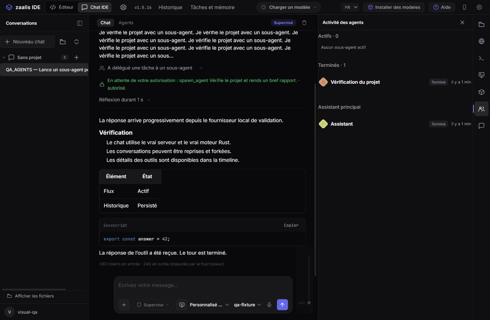

# Progress text and delegated agent activity — 2026-10-15

Progress before a tool call is now limited to **280 Unicode characters per
provider round**, including the ellipsis. The first 279 characters stream
immediately. Remaining text is held until the runtime knows whether the model
is calling tools or finishing its answer. A final answer is released completely;
the runtime retains the complete provider text in its model history. Long final
answers therefore stream their initial preview, then receive the remaining text
when that provider round finishes. This display guard does not reduce already
generated provider tokens.

The shared runtime prompt asks for one short useful progress sentence, direct
tool execution for routine steps, a concise final report by default, and detailed
explanations when requested. Explicit delegation requests instruct the model to
use `spawn_agent` with a descriptive role label, bounded background work and
status/wait tools. Those four delegation tools remain advertised in the reduced
catalogue used by small context windows. Permissions, model ability and budgets
still determine whether a request can actually execute.

The activity panel now has **Actifs** and **Terminés** groups with counts,
descriptive child names, stable identity colors, relative timestamps, expandable
objectives/reports, failure/cancellation states and stop controls. The principal
assistant appears separately. Native completion/cancellation events and tagged
states are handled directly. Saved conversations preserve the child history;
refreshes preserve expanded cards. Relative ages refresh every minute while the
panel is visible.

Implementation is split between `rust/crates/zaalis-agent/src/progress.rs`, the
shared prompt/runner, and `interface/script/agent-activity.js`. The existing
workspace delegates its activity view model and rendering to that small module.

Validation:

- **194 Node tests** and **493 Rust tests**, no failures.
- Runtime regression: verbose Unicode progress stays within 280 characters;
  a long detailed final answer and the provider's full context remain intact.
- UI regression: active/completed groups, terminal reports/errors, stop action,
  stable timestamps and expanded-card preservation.
- Actual browser, HTTP server and native daemon: permission approval, real
  background child launch, active → completed transition, expandable report,
  reload and conversation re-opening. DOM measurement confirms 280 characters.
- Packaged-server/runtime integration and packaged smoke checks passed.
- Visual/model traffic used a deterministic loopback provider. No live test of
  Mistral 3 3B was performed; another real model was not substituted.

Updated runtime, server and interface are staged in `native/dist`. Inno Setup
packages them into `native/installer/zaalis-setup.exe`, version 1.0.16. No installer
was run and no changes were pushed.

